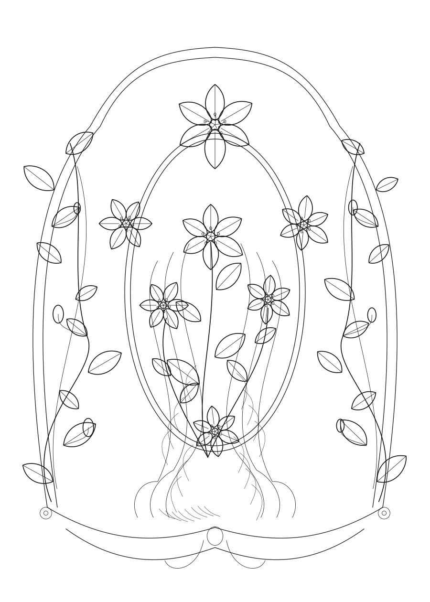

# Nouveau Line Studio

**Generative black-and-white Art Nouveau ornament, designed for pen plotting.**

[](https://gwb2025.github.io/nouveau-line-studio/)

**GitHub Pages launch address:** <https://gwb2025.github.io/nouveau-line-studio/>

> **Publishing status:** the button will work once the `GWB2025/nouveau-line-studio` repository has been created, its files pushed to `main`, and **Settings → Pages → Build and deployment → Source: GitHub Actions** selected. Until then the URL may return 404. Do not report the site as live until verified.

## Milestone 01 — Botanical ornament (evaluation release)

The first release creates **original** monochrome Art Nouveau-inspired floral ornaments. It does not copy Mucha's drawings or claim to generate human figures yet.

- Reproducible random seed; different seeds create different drawings.
- Lily, poppy and iris-inspired motifs; adjustable foliage density, curvature and fine hatching.
- Three portrait paper formats: A4, A5 and A6.
- Four individually selectable SVG stroke layers: frame, outlines, detail and hatching.
- No raster images, filled shapes, external fonts or network requests in the generated artwork.
- An indicative pen-down distance and path count; these are **not** a physical plotting-time estimate.
- Works entirely in the browser with no account and no third-party dependencies.



[Open an example A4 SVG](samples/nouveau-lily-seed-20261107-A4.svg)

### Launch locally

1. Extract the project into `~/Documents/Projects/Generative-Art/Nouveau-Line-Studio` on your Mac, or another backed-up development folder.
2. Open Terminal in that folder and run `python3 -m http.server 8000`.
3. Open <http://localhost:8000> in Safari or Chrome.

Alternatively, with Node.js 20 or later:

```bash
npm run serve
```

A local HTTP server is required for JavaScript modules. Opening `index.html` directly with `file://` is not supported in all browsers.

### Test-driven development

Tests were written first (confirmed failing due to missing modules), then functionality was implemented from the bottom up: deterministic random generator → geometry/path measuring → botanical primitives → SVG generation → browser UI.

```bash
npm test        # Node.js built-in test runner, no npm install needed
npm run check   # Tests + sample SVG validation/generation
```

`npm run check` creates or refreshes `samples/nouveau-lily-seed-20261107-A4.svg` and checks the SVG path count. The CI workflow runs the same command before deploying Pages.

### Export to Writing Robot T-A4

1. Choose an A4, A5 or A6 portrait format and a seed.
2. Disable any pen layers you do not wish to plot.
3. Select **Export SVG for plotter**.
4. Import the SVG into your SVG Plotter app. First inspect the path count, physical scaling and preview; begin with a small low-density test plot.

All layers use open or continuous stroked `<path>` elements, with simple groups, black strokes and no fills. **The SVG Plotter import and physical T-A4 run have not yet been tested.** Previewing in a web browser is not evidence of hardware compatibility.

## Project layout

```text
nouveau-line-studio/
├── README.md
├── index.html                  # Browser UI and semantic controls
├── styles.css                  # Offline UI styling
├── favicon.svg
├── src/
│   ├── prng.js                 # Seeded deterministic PRNG
│   ├── geometry.js             # Bézier and path primitives
│   ├── botany.js               # Procedural botanical composition
│   ├── generator.js            # Pure generator and SVG export
│   └── app.js                  # Browser event handling
├── tests/                      # 13+ node:test unit tests
├── scripts/validate.mjs        # Reproducible sample validation
├── samples/                    # A4 example SVG and preview image
├── docs/VALIDATION.md          # Evidence and physical test checklist
├── docs/ROADMAP.md             # Stage gates before continuing
└── .github/workflows/ci-pages.yml
```

## Release stages and acceptance gates

| Stage | Scope | Gate before next stage |
|---|---|---|
| **01 — now** | Seeded ornamental flora, curves, SVG layers, paper sizes, UI | Automated tests; visual evaluation; SVG Plotter import; physical T-A4 small plot |
| **02 — planned** | More authentic Art Nouveau botanicals, line-hatching and compositional grammars | Repeatability, style evaluation, complexity budgets and physical plots |
| **03 — planned** | Parametric face/figure outlines, hairstyles, drapery | Anatomy and composition review; plotted figure tests |
| **04 — optional** | AI-assisted figures followed by vector simplification | Quality, licensing, offline/cloud costs, and SVG plot quality reviewed separately |

**No stage proceeds automatically.** Stage 02 requires explicit review of Stage 01 results.

### Engineering approach

Milestone 01 uses **small, testable, pure JavaScript ES modules** and HTML/CSS: this is a deliberate zero-build starting point for reliable GitHub Pages delivery. We will evaluate moving mathematically intensive core modules to **Rust/WebAssembly** later, with `cargo test` tests written before migrating behaviour, when the build/deployment complexity is justified. Geometry and SVG export are kept separate from DOM code to avoid reimplementation.

### Publication (once only)

You can create and push the repository from the project directory using the GitHub CLI, if installed and authenticated:

```bash
git init -b main
git add .
git commit -m "feat: milestone 01 botanical SVG generator (TDD)"
gh repo create GWB2025/nouveau-line-studio --public --source=. --remote=origin --push
```

Then select **GitHub Actions** as the Pages source in repository Settings → Pages. The workflow tests on every push and deploys `main` to Pages. If you prefer the GitHub website, create an **empty public repository** named `nouveau-line-studio` first; push these files to `main` (do not initialise with a competing README).

### Scope and limitations

This is an exploratory software artefact; the florals are stylised and **not** portraits or exact reconstructions of Alphonse Mucha artwork. Stroke width in the SVG is a visual aid and actual pen width is determined by your chosen pen. The reported pen-down distance approximates the actual distance by sampling Bézier curves; it excludes pen-up movements and plotter overhead.

**Licence:** MIT for original code. © 2026 Nouveau Line Studio contributors.
