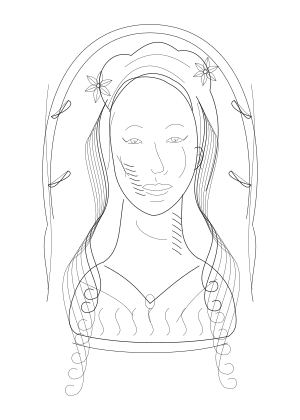

# Nouveau Line Studio

**Original black-and-white Art Nouveau-inspired portraits, figures and botanical compositions for pen plotting.**

[](https://gwb2025.github.io/nouveau-line-studio/)

**GitHub Pages launch address:** <https://gwb2025.github.io/nouveau-line-studio/>

> **Publishing status:** GitHub Pages is deployed from `main` via GitHub Actions. The latest **Milestone 3.2a** release adds the first curated portrait. SVG conversion and software tests pass, but the new portrait still needs artistic review and a physical T-A4 trial.

## Milestone 03.2a — Curated Portrait Library (first portrait for review)

The **Curated portrait** mode uses an **individually authored, fixed face and
hairstyle** rather than trying to generate realistic anatomy from random
parameters. The first portrait, **01 — The Muse (frontal lilies)**, takes its
artistic direction from the floral-crowned woman in Mucha's *Sarah Bernhardt*
tribute poster. It is our own hand-curated vector interpretation, not a literal
tracing or a claim of reproducing the historical portrait. The uploaded small
reference image is **not** embedded in any artwork.

- **[Open the complete A6 composition](samples/nouveau-curated-muse-01-A6.svg)**
- **[Open only the fixed portrait SVG](assets/portraits/muse-01.svg)**
- **[Portrait asset catalogue and provenance](assets/portraits/README.md)**

The **seed**, **flower type**, **density**, **curvature** and **symmetry** alter
only the *surrounding ornament*. The face, eyes, lips, hair and clothing remain
stable and suitable for review. The layer checkboxes let users suppress the
background or shading while retaining true pen strokes. The application
currently offers **only one portrait**. Portraits 02–06 are future slots, not
finished images, and will be selected after your evaluation of number 01.

The initial A6 example uses seed `20261108`, lilies and the oval halo:
**157 paths**, approximately **3.70 m** of pen-down travel, 105 × 148 mm.
All SVG geometry is drawn in cubic Bézier curves or lines, with no embedded
bitmap, filled black areas or SVG transforms. A purely procedural *Expressive
portrait* remains separately selectable for comparison.

**Acceptance gate:** inspect the face and hair against the supplied references;
import the complete A6 SVG and standalone face into SVG Plotter; check scale
and details; perform a physical plot before producing the other five portraits.

## Milestone 03.1 — Expressive portrait study (experimental review)

The new **Expressive portrait** option gives the face much more space and
attention than the original Milestone 3 full-figure drawing. It is built directly
from Bézier paths, with individually planned facial landmarks, restrained
half-lidded almond eyes, expressive brows, a modelled nose, carefully shaped
lips and soft cheek/neck contours. Long hair is drawn as separate flowing
whiplash curves; small flower ornaments sit in the hair, and an open double
nimbus concentrates attention on the woman's face.

The new **Eye expression and gaze** control offers **Serene / half-lidded**,
**Direct gaze** and **Looking aside**. Different seeds, poses, hairstyles,
clothing and hatching can produce different drawings. New values update the
preview continuously while sliders are dragged.

[**View the new A6 face study in SVG**](samples/nouveau-portrait-seed-20261108-A6.svg)
· [SVG preview](samples/nouveau-portrait-seed-20261108-A6.svg)

The old **Original figure**, **Organic** and **Classic** engines are still
available. Their known sample SVGs retain exactly the same SHA-256 hashes.
The new face geometry is a **first refinement for visual review**, not a claim
of exact resemblance to Mucha's hand-drawn figure studies. Physical T-A4
plotting and Safari testing of the new portrait remain outstanding.

## Milestone 03 — Parametric figurative studies (evaluation release)

Milestone 3 introduces a third, entirely procedural engine. It draws **stylised human faces, hair and upper-body clothing directly as plotter-friendly SVG paths**. The geometric illustrations are original, not copies of Mucha's drawings, and deliberately do **not** claim photorealistic anatomy. Use the composition selector to switch between **Expressive portrait**, the original **Figurative** study, **Organic** and **Classic**.

- **Pose:** frontal, three-quarter and right-facing profile contour grammars.
- **Hairstyles:** flowing waves, chignon/updo and a decorative braid.
- **Drapery:** flowing gown with a pendant, or a draped shawl.
- **Botanical surrounds:** seeded lilies, irises or poppy-inspired stylisations arranged beside the figure.
- **Frames:** retain arch, halo and trellis frames from Milestone 2.
- **Curve expression / hatching:** affect the figure's garments, hair and separate pen-shading layer, with live preview redraw while dragging sliders.
- **Compatibility:** existing A4/A5/A6 paper sizes, seeded reproducibility, plotter-safe curves and 4 independent SVG layers. No SVG transforms, bitmap images, fonts or cloud AI services.
- **Protection:** the user-approved Classic SVG and Milestone 2 Organic A6 sample retain exact SHA-256 regression hashes.

**[Open the new A6 figurative sample](samples/nouveau-figure-seed-20261108-A6.svg)** (seed `20261108`, three-quarter view, flowing hair, gown and oval halo; **133 paths, about 2.94 m of pen-down motion**). Other poses and hairstyles may have different path counts.

### Acceptance gate before Milestone 4

Please check the **anatomy**, **stylistic quality** and **SVG Plotter import** independently. Start with the saved A6 sample, then test different poses and hair. Physically plot at least one figure using the T-A4 before deciding whether the procedural approach needs improving or whether AI-assisted figures are worthwhile. **We will not begin Milestone 4 without a new decision.** The previously outstanding Milestone 2 physical checks remain open separately; the user explicitly authorised implementation of Milestone 3.

## Milestone 02 — Expressive botanical compositions (evaluation release)

Milestone 2 adds an **Organic** generator without altering the **Classic** engine. Select **Load Milestone 1 reference** to recover the original A6 seeded artwork exactly. The zero-build, dependency-free browser app still exports plain stroked SVG with the same four plotter layers.

- **Flowers:** lilies, irises, poppies or a mixed bouquet, with seeded natural petal variations.
- **Composition:** flower-placement symmetry from paired (100%) to intentionally asymmetric (0%); protective spacing between blossoms.
- **Frames:** architectural double arch, oval halo or trellis.
- **Curve expression:** changes organic stem sweeps, petal fullness and leaf shapes throughout the 0–100% range.
- **Fine hatching:** changes the actual number and length of pen paths continuously across the slider; 0% removes shading. Keep the **Shading lines** layer enabled to see it.
- **Live controls:** slider movements regenerate the preview at the next animation frame, without requiring mouse release.
- **Shading:** separate contour or crosshatching paths with conservative minimum separation.
- **Paper:** A4, A5 or A6 portrait, adjustable artwork scale (50–130%) and minimum physical margin (0–20 mm). Bounds are measured from Bézier curves; actual scale is reduced when needed to avoid clipping.
- **Testing:** original Milestone 1 SVG regression hash, deterministic seeded variation, paper geometry, shading isolation, frame switching, SVG sanitisation, plotting complexity and static UI checks.

**[Open the new Milestone 2 example SVG](samples/nouveau-mixed-seed-20261108-A6.svg)** (A6, seed `20261108`, 312 paths, approximately 2.76 m pen-down). The previous A4 sample remains available below.

**Important:** Milestone 2 and its slider fix are software-validated. It still needs independent evaluation in Safari, SVG Plotter and on the physical T-A4 before sign-off. A successful Milestone 1 plot is not proof that this new geometry plots correctly.

## Milestone 01 — Botanical ornament (validated reference)

The original release creates **original** monochrome Art Nouveau-inspired floral ornaments. It does not copy Mucha's drawings; it remains available unchanged alongside the newer figurative generator.

- Reproducible random seed; different seeds create different drawings.
- Lily, poppy and iris-inspired motifs; adjustable foliage density, curvature and fine hatching.
- Three portrait paper formats: A4, A5 and A6.
- Four individually selectable SVG stroke layers: frame, outlines, detail and hatching.
- No raster images, filled shapes, external fonts or network requests in the generated artwork.
- An indicative pen-down distance and path count; these are **not** a physical plotting-time estimate.
- Works entirely in the browser with no account and no third-party dependencies.



[View the original Milestone 3 figure](samples/nouveau-figure-seed-20261108-A6.svg)

[View the Milestone 2 botanical sample](samples/nouveau-mixed-seed-20261108-A6.svg)

Classic reference: 

[Open an example A4 SVG](samples/nouveau-lily-seed-20261107-A4.svg)

### Launch locally

1. Extract the project into `~/Documents/Projects/Generative-Art/Nouveau-Line-Studio` on your Mac, or another backed-up development folder.
2. Open Terminal in that folder and run `python3 -m http.server 8000`.
3. Open <http://localhost:8000> in Safari or Chrome.

Alternatively, with Node.js 20 or later:

```bash
npm run serve
```

A local HTTP server is required for JavaScript modules. Opening `index.html` directly with `file://` is not supported in all browsers.

### Test-driven development

Tests were written first (confirmed failing due to missing modules), then functionality was implemented from the bottom up: deterministic random generator → geometry/path measuring → botanical primitives → SVG generation → browser UI.

```bash
npm test        # Node.js built-in test runner, no npm install needed
npm run check   # Tests + sample SVG validation/generation
```

`npm run check` refreshes all five validated example SVGs and the curated face-only asset and validates their path counts, lengths and clipping margins. The CI workflow runs the same command before deploying Pages.

### Export to Writing Robot T-A4

1. Choose an A4, A5 or A6 portrait format and a seed.
2. Disable any pen layers you do not wish to plot.
3. Select **Export SVG for plotter**.
4. Import the SVG into your SVG Plotter app. First inspect the path count, physical scaling and preview; begin with a small low-density test plot.

All layers use open or continuous stroked `<path>` elements, with simple groups, black strokes and no fills. The **Classic** drawing has been imported and plotted successfully on the T-A4. The **Organic**, original **Figurative**, and new **Expressive portrait** drawings still need separate physical tests. Previewing in a web browser is not evidence of hardware compatibility.

## Project layout

```text
nouveau-line-studio/
├── README.md
├── index.html                  # Browser UI and semantic controls
├── styles.css                  # Offline UI styling
├── favicon.svg
├── src/
│   ├── prng.js                 # Seeded deterministic PRNG
│   ├── geometry.js             # Bézier and path primitives
│   ├── layout.js               # Physical margin/scale fitting
│   ├── composition.js          # Organic flower planning and safe hatching
│   ├── organic.js              # Milestone 2 compositions and reusable frames
│   ├── portrait-landmarks.js # Expressive face anatomy and gaze landmarks
│   ├── portrait.js           # Close-up facial study and flowing hair
│   ├── figure-primitives.js    # Stable facial landmarks and pose projection
│   ├── figure.js               # Milestone 3 vector faces, hair, drapery and ornaments
│   ├── botany.js               # Procedural botanical composition
│   ├── generator.js            # Pure generator and SVG export
│   ├── live-controls.js        # Responsive frame-scheduled redraws
│   └── app.js                  # Browser event handling
├── tests/                      # 81 node:test regression and behavioural tests
├── scripts/validate.mjs        # Reproducible sample validation
├── assets/portraits/           # Curated, reusable vector portrait library
├── samples/                    # Seeded SVG examples and previews
├── docs/VALIDATION.md          # Evidence and physical test checklist
├── docs/ROADMAP.md             # Stage gates before continuing
└── .github/workflows/ci-pages.yml
```

## Release stages and acceptance gates

| Stage | Scope | Gate before next stage |
|---|---|---|
| **01 — passed** | Seeded ornamental flora, curves, SVG layers, paper sizes, UI | Automated tests; visual evaluation; SVG Plotter import; physical T-A4 small plot |
| **02 — implemented** | More authentic Art Nouveau botanicals, line-hatching and compositional grammars | Technical checks pass; physical botanical acceptance remains open |
| **03 — refinement** | Parametric figures plus new enlarged, expressive face study | Anatomy and face-expression review; SVG Plotter import; plotted portrait test |
| **04 — optional** | AI-assisted figures followed by vector simplification | Quality, licensing, offline/cloud costs, and SVG plot quality reviewed separately |

**No stage proceeds automatically.** The first curated portrait is explicitly authorised; the other five remain on hold until its artistic quality and plotting have been reviewed.

### Engineering approach

Milestone 01 uses **small, testable, pure JavaScript ES modules** and HTML/CSS: this is a deliberate zero-build starting point for reliable GitHub Pages delivery. We will evaluate moving mathematically intensive core modules to **Rust/WebAssembly** later, with `cargo test` tests written before migrating behaviour, when the build/deployment complexity is justified. Geometry and SVG export are kept separate from DOM code to avoid reimplementation.

### GitHub Pages publication

The public repository is <https://github.com/GWB2025/nouveau-line-studio>. Updates to `main` trigger the [test-and-deploy workflow](https://github.com/GWB2025/nouveau-line-studio/actions/workflows/ci-pages.yml). Deployments are gated on the automated tests. To update a checkout that has not yet received Milestone 2:

```bash
cd ~/Documents/Projects/Generative-Art/nouveau-line-studio
git pull --ff-only
npm run check
```

Under **Settings → Pages**, the source should remain **GitHub Actions**. The README launch badge opens the latest successful `main` deployment.

### Scope and limitations

This is an exploratory software artefact; the florals are stylised and **not** portraits or exact reconstructions of Alphonse Mucha artwork. Stroke width in the SVG is a visual aid and actual pen width is determined by your chosen pen. The reported pen-down distance approximates the actual distance by sampling Bézier curves; it excludes pen-up movements and plotter overhead.

**Licence:** MIT for original code. © 2026 Nouveau Line Studio contributors.